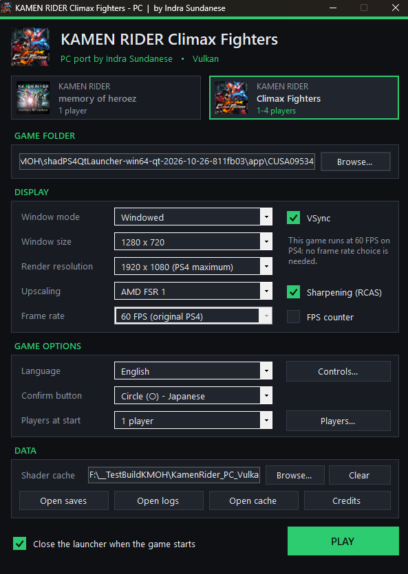

<div align="center">

# KAMEN RIDER - PC

**Port PC oleh Indra Sundanese**

2 game KAMEN RIDER dari PS4 berjalan di Windows dengan Vulkan, dalam 1 launcher.




</div>

---

> [!IMPORTANT]
> **Tidak ada file game yang disertakan.** Kamu membutuhkan dump game dari konsol milikmu sendiri.

## Game yang Didukung

| Game | Title ID | Pemain | Status |
|---|---|---|---|
| KAMEN RIDER memory of heroez | CUSA17374 | 1 pemain | ✅ Bisa dimainkan |
| KAMEN RIDER Climax Fighters | CUSA09534 | 1-4 pemain (lokal) | 🚧 Baru sampai menu, belum bisa masuk gameplay |

> [!WARNING]
> **Climax Fighters masih dalam pengembangan.** Saat ini game sudah bisa boot sampai menu utama,
> tetapi belum bisa masuk ke gameplay. Fitur multiplayer lokal di bawah sudah disiapkan untuk saat gameplay berjalan.

## Tentang Proyek Ini

Runtime dan launcher PC untuk 2 game PlayStation 4: **KAMEN RIDER memory of heroez** dan **KAMEN RIDER Climax Fighters**.

- Kode x86-64 milik game dijalankan langsung di prosesor PC.
- Library sistem PS4 diimplementasikan ulang di PC.
- Perintah GPU dan shader diterjemahkan ke Vulkan.

Perangkat lunak (free software) di bawah lisensi GNU GPL v2 atau versi yang lebih baru. Kredit lengkap ada di [`NOTICE.md`](NOTICE.md).

## Persyaratan Sistem

| Komponen | Minimum |
|---|---|
| Sistem operasi | Windows 10 atau 11, 64-bit |
| Prosesor | CPU yang mendukung AVX2 |
| Kartu grafis | Mendukung Vulkan 1.3, dengan driver terbaru |

## Cara Bermain

1. Siapkan dump game milikmu sendiri (folder yang berisi `eboot.bin`, base game + update sudah digabung).
   Taruh masing-masing game di foldernya sendiri di dalam `game\`, misalnya:
   ```
   game\KMOH   KAMEN RIDER memory of heroez
   game\KRCF   KAMEN RIDER Climax Fighters
   ```
   Atau pilih folder game di lokasi lain lewat tombol **Browse...** di launcher.
2. Buka `KAMEN RIDER Launcher.exe`, pilih game di bagian atas, atur pengaturan yang kamu mau, lalu tekan **PLAY**.

> [!NOTE]
> Saat pertama kali dijalankan, game akan meng-compile shader dan akan patah-patah (stutter) untuk sementara.
> Shader yang sudah di-compile disimpan di shader cache, jadi permainan berikutnya akan lebih lancar.

## Isi Folder

```
KAMEN RIDER Launcher.exe   pilih game, pengaturan dan tombol mulai
bin\                       runtime (kmoh-core.exe)
game\                      dump game milikmu (lokasi opsional)
user\                      save, shader cache (kecuali dipindah), log, kontrol, pengaturan
```

## Opsi Launcher

Pengaturan disimpan **terpisah untuk masing-masing game**.

| Opsi | Pilihan |
|---|---|
| Mode jendela | Windowed, Borderless fullscreen, Exclusive fullscreen |
| Ukuran jendela | 720p, 900p, 1080p, 1440p, 4K |
| Resolusi render | 720p atau 1080p (maksimum PS4) |
| Upscaling | Mati atau AMD FSR 1, dengan opsi penajaman RCAS |
| Frame rate | **memory of heroez:** 30 FPS (asli) atau 60 FPS (eksperimental)<br>**Climax Fighters:** 60 FPS (asli) |
| Lainnya | VSync, penghitung FPS, bahasa (Inggris, Jepang, Mandarin Tradisional, Korea), tombol konfirmasi |
| Controls... | Pemetaan keyboard (dua tombol per aksi, per pemain) dan controller |
| Players... | Jumlah pemain saat mulai dan nama pemain (Climax Fighters) |
| Shader cache | Folder untuk shader yang sudah di-compile (bawaan `user\cache`); tombol **Clear** untuk membangun ulang |

Semua pengaturan disimpan di folder `user\` (portable).

## Multiplayer Lokal (Climax Fighters)

- Controller (XInput, DualShock 4, DualSense) masuk sebagai Player 1-4 sesuai urutan saat dicolokkan.
- **Players at start** memungkinkan pemain tanpa controller ikut bermain pakai keyboard. Atur tombolnya di
  **Controls...** (pilih pemainnya di kanan atas).
- **Players...** untuk mengatur nama pemain.
- Di dalam game: **F5** menambah pemain, **F4** mengeluarkan pemain terakhir.

## Kontrol

Controller (XInput, DualShock 4, DualSense) langsung bisa dipakai.
Ubah tombol keyboard dan tombol controller lewat **Controls...** di launcher.
Setiap game punya file kontrolnya sendiri: `user\input_config\<TITLE_ID>.ini`.

## Dibangun di Atas

| Karya | Pembuat | Lisensi |
|---|---|---|
| **shadPS4**: seluruh runtime - loader, library sistem PS4, GPU command processor, shader recompiler (GCN ke SPIR-V) dan renderer Vulkan, termasuk FSR 1 / RCAS | Tim dan kontributor shadPS4 | GPL-2.0-or-later |
| SDL3, Vulkan headers dan loader, Vulkan Memory Allocator, glslang, sirit, Dear ImGui, FFmpeg, OpenAL Soft, LibAtrac9, fdk-aac, fmt, spdlog, nlohmann json, toml11, zlib-ng, zstd, xbyak, Zydis, magic_enum, robin-map, half, xxHash, Boost, LibreSSL, dan library lain di folder `externals` shadPS4 | Para pembuatnya masing-masing | Lisensi masing-masing |
| AMD FidelityFX Super Resolution 1 (FSR 1) | AMD | MIT |

Pendekatan ini terinspirasi dari port PC native Bloodborne (bloodborne_pc) dan God of War III (SpartanPort),
yang juga dibangun di atas shadPS4.

## Versi

```
KAMEN RIDER - PC 1.1 (Vulkan): memory of heroez + Climax Fighters - Port PC oleh Indra Sundanese
```

### Riwayat Perubahan

**1.1**
- Launcher baru: **KAMEN RIDER Launcher**, dua game dalam satu launcher.
- Dukungan awal **KAMEN RIDER Climax Fighters** (sudah sampai menu, gameplay belum bisa).
- Multiplayer lokal hingga 4 pemain, termasuk pemain keyboard dan nama pemain.
- Pengaturan dan file kontrol terpisah untuk setiap game.

**1.0**
- Rilis pertama: KAMEN RIDER memory of heroez.

## Melaporkan Masalah

Lampirkan file `user\log\shad_log.txt` di laporanmu dan sebutkan game yang mana.

## Lisensi

GNU General Public License, versi 2 atau (sesuai pilihanmu) versi yang lebih baru. Lihat [`LICENSE`](LICENSE).
Siapa pun yang menerima build dari proyek ini berhak mendapatkan source code-nya, termasuk perubahan-perubahannya.

---

<sub>"KAMEN RIDER", "memory of heroez" dan "Climax Fighters" adalah merek dagang milik pemiliknya masing-masing (Ishimori Production, Toei,
Bandai Namco Entertainment). Proyek ini tidak berafiliasi dengan mereka maupun dengan Sony Interactive Entertainment.</sub>
